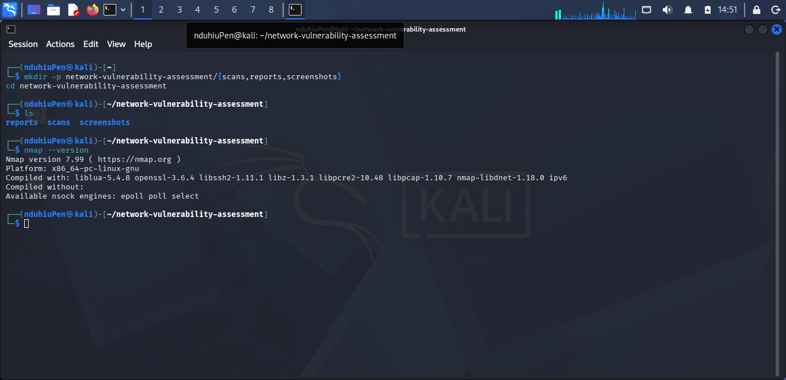
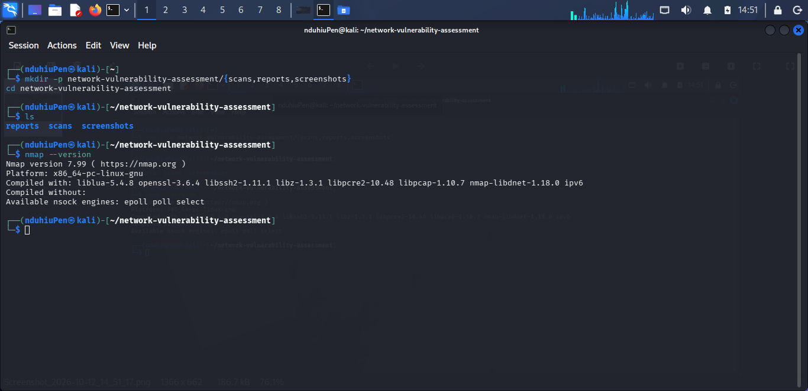
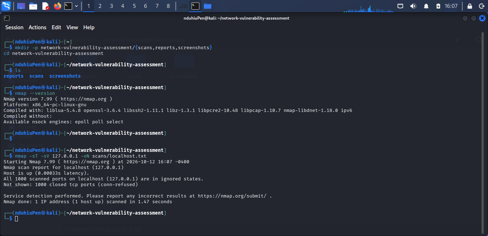

# Lab 1: Network Reconnaissance & Vulnerability Assessment

A beginner-friendly cybersecurity lab documenting the initial reconnaissance workflow used to identify exposed TCP ports and services on a local machine using **Nmap**.

> **Scope note:** This lab documents a scan of `127.0.0.1` (localhost). Only scan systems you own or have explicit permission to assess.

## Objectives

- Confirm that Nmap is installed and identify its version.
- Organize assessment artefacts into a repeatable project structure.
- Run a TCP connect scan with service/version detection requested.
- Save scan output for later review.
- Interpret the observed results, record limitations, and recommend next steps.

## Lab Environment

- **Operating system:** Kali Linux or Ubuntu (as described in the lab notes)
- **Tool:** Nmap
- **Target:** `127.0.0.1` — the local machine
- **Assessment date:** 12 October 2026
- **Level:** Beginner
- **Activity type:** Local network reconnaissance

## Repository Structure

The lab workspace is organized as follows:

```text
network-vulnerability-assessment/
├── README.md
├── scans/
│   └── localhost.txt
├── reports/
│   └── assessment-report.md
└── screenshots/
    ├── Screenshot_2026-10-12_14_51_17.png
    ├── Screenshot_2026-10-12_14_51_46.png
    └── Screenshot_2026-10-12_16_07_45.png
```

The filenames above reflect the evidence referenced in the lab notes. Ensure the original scan output and screenshot files are present in the repository before relying on these paths.

## Procedure

### 1. Check Nmap installation

```bash
nmap --version
```

The lab screenshot shows Nmap version `7.96`.

### 2. Create the project folders

Run this command from the directory where you want the project folder created:

```bash
mkdir -p network-vulnerability-assessment/{scans,reports,screenshots}
cd network-vulnerability-assessment
```

If the repository already exists, create only any missing folders:

```bash
mkdir -p scans reports screenshots
```

### 3. Scan localhost

```bash
nmap -sT -sV 127.0.0.1 -oN scans/localhost.txt
```

**Command breakdown**

| Option / value | Meaning |
|---|---|
| `-sT` | Use a TCP connect scan |
| `-sV` | Request service/version detection for discovered services |
| `127.0.0.1` | Target the local host |
| `-oN scans/localhost.txt` | Save normal-format output to the specified file |

### 4. Review and preserve the evidence

- Review the terminal output and the saved `scans/localhost.txt` file.
- Keep screenshots in `screenshots/`.
- Record the target, date/time, exact command, Nmap version, results, and any follow-up checks in the report.
- Keep the raw output unmodified so the assessment can be reviewed and reproduced.

## Results Summary

According to the scan output documented in the lab PDF:

- The target `127.0.0.1` was reported as up.
- Nmap scanned its default set of **1,000 TCP ports**.
- All 1,000 ports were reported in an ignored state, and no open ports were listed in the captured output.
- The scan completed in approximately **1.47 seconds**.
- No confirmed vulnerability was established by this scan.

These results apply only to the target and scan conditions documented here. They do **not** prove that the host or network is free of vulnerabilities.

## Findings and Recommended Actions

| Finding | Status / severity | Recommended action |
|---|---|---|
| No open TCP ports observed in the scanned default port set | Informational / low concern from this scan | Compare observed exposure with expected services; review listening sockets and firewall rules. |
| Software support and patch status not verified | Unconfirmed; no vulnerability established | Inventory installed packages and applications, check official vendor advisories, and apply approved updates. |
| Assessment coverage is limited to localhost and the default TCP port set | Low-severity coverage limitation | Define authorized scope and consider additional TCP, UDP, configuration, or application checks where appropriate. |

See [`reports/assessment-report.md`](reports/assessment-report.md) for the full report, including methodology, evidence references, limitations, and remediation guidance.

## Evidence

The lab PDF references these screenshots:

- `Screenshot_2026-10-12_14_51_17.png` — Nmap availability and workspace setup.
- `Screenshot_2026-10-12_14_51_46.png` — Nmap/environment information referenced in the lab notes.
- `Screenshot_2026-10-12_16_07_45.png` — localhost scan command and results.

If you add the images to the `screenshots/` directory, you can display them in GitHub by uncommenting or adding the following examples with paths that match the committed filenames:

```markdown





```

## Limitations

- The documented target is localhost only.
- The evidence records a scan of the default 1,000 TCP ports, not all TCP ports.
- No UDP scan is documented.
- No vulnerability-script scan, exploitation, application testing, or manual validation is documented.
- The raw `scans/localhost.txt` file was not supplied separately with the lab PDF; verify that it exists and commit it if available.
- Installed package versions and patch status were not established by the scan evidence.

## Next Steps

1. Preserve the raw Nmap output and original screenshots.
2. Document authorization and exact scope before testing any additional asset.
3. Review local listening sockets and firewall rules.
4. If authorized and appropriate, scan the full TCP port range and document the additional coverage.
5. Consider a separately scoped UDP assessment where required.
6. Verify operating-system and application patch status using package inventory and official vendor advisories.
7. Validate any suspected issue before assigning a confirmed severity.
8. Retest after remediation and update the report with the result.

## Safety and Authorization

This repository is for learning and authorized security testing. Do not scan third-party systems, networks, or applications without explicit permission. Keep testing within the agreed scope and avoid disruptive testing unless it is specifically authorized.

## Deliverables

- [x] Lab procedure documented
- [x] Initial localhost scan command recorded
- [x] Results and limitations summarized
- [x] Remediation and next steps documented
- [ ] Raw Nmap output committed to `scans/localhost.txt` (verify availability)
- [ ] Referenced screenshots committed to `screenshots/` (verify availability)

---

**Related report:** [`reports/assessment-report.md`](reports/assessment-report.md)
